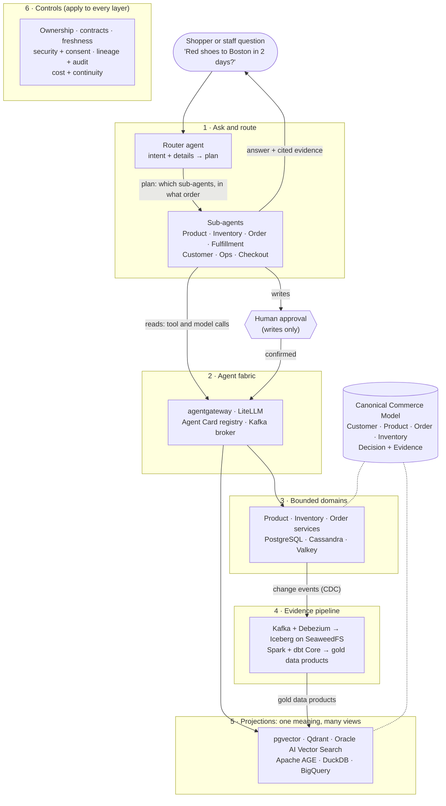

# Architecture

Six layers, each built from free and open-source parts. A router agent answers each question through domain sub-agents that share one canonical commerce model. See the [vision](vision.md), [principles](principles.md) and [capability map](capability-map.md).

## How a question flows

The router turns the question into intents and details ("red shoes", "Boston", "2 days") and plans which sub-agents to call, in what order. Each sub-agent reaches data only through the agent fabric, which handles identity, model access and tracing: live records come from the domain services, and search, analytics and graph questions go to the projections. Every change in a domain flows as an event through the evidence pipeline into gold data products, which keep the projections current. All of it speaks the canonical model, so "in stock" means the same thing everywhere. The router merges the sub-agents' results into one answer that cites its evidence, and any action that changes an order, an account or money stops for human approval first.

## Where the principles apply

| Principle | Where it shows in the diagram |
| --- | --- |
| P1 One canonical meaning | The canonical model, shared by domains and projections |
| P2 One owner per data product | Each domain service writes only its own data; others read through the fabric or the projections |
| P3 Every answer cites evidence | The "answer + cited evidence" arrow back to the question |
| P4 No write without human approval | The approval step on the write path |
| P5 Measure before you trust | Evals on the router and sub-agents, enforced by the controls layer |
